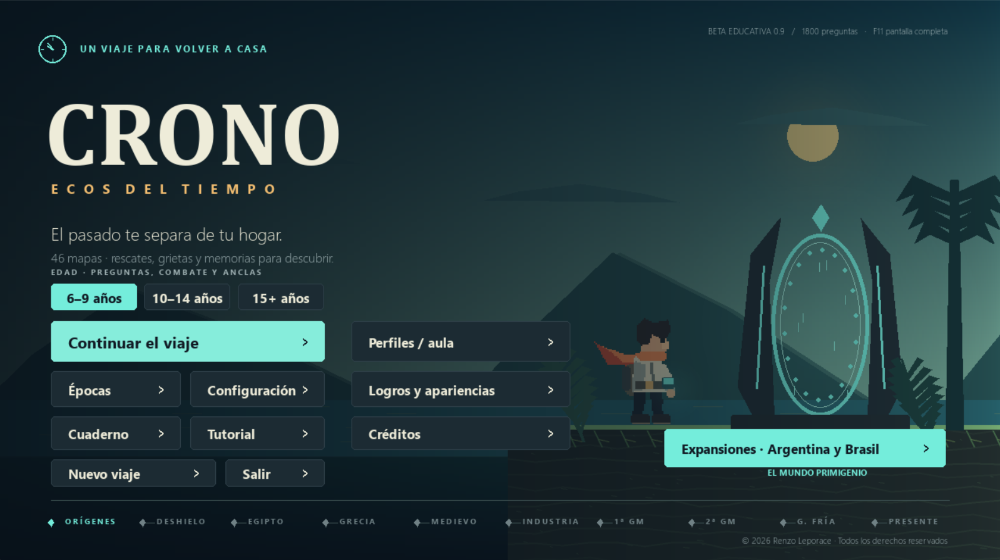

# Renzo Leporace

Desarrollo aplicaciones, juegos y experiencias web. Me interesa combinar interfaces claras con herramientas útiles y proyectos que inviten a aprender.

**Trabajo con:** Python · pygame-ce · Dart · Flutter · C# · .NET · JavaScript · Git

---

## Proyecto destacado · CRONO: Ecos del tiempo

**[CRONO](https://github.com/RenzoLeporace/crono-runner)** es un juego educativo de plataformas en 2D para Windows y Android. Sus misiones recorren distintas épocas históricas y combinan exploración con preguntas adaptadas por edad. También incluye herramientas para que docentes seleccionen y editen contenidos.

**Tecnologías:** Python y pygame-ce · **Estado:** beta educativa

## Proyectos propios

| Proyecto | Qué hace | Tecnologías |
| --- | --- | --- |
| [Mi espacio](https://github.com/RenzoLeporace/habit-tracker-v4) · [Demo](https://renzoleporace.github.io/habit-tracker-v4/) | Reúne hábitos, rutina, tareas semanales y finanzas personales en una app con datos locales. | Flutter, Dart |
| [Sistema de Gestión Gruppe Sechs](https://github.com/RenzoLeporace/sistema-gestion-gruppe-sechs) | Organiza clientes, contratos, servicios, personal, vehículos y facturación de una empresa de seguridad. | C#, .NET, Windows Forms |

## Colaboraciones

- **[WO Definitive Edition](https://github.com/federicoviceconte5-jpg/wo-definitive)** · Juego multijugador desarrollado en equipo.
- **[Khalifa Barbershop](https://github.com/federicoviceconte5-jpg/khalifa-barbershop)** · Proyecto académico de barbería con catálogo, contacto y panel de novedades. Usa React, Express y MySQL.
- **[WO Guardian](https://github.com/federicoviceconte5-jpg/bot-discord)** · Bot de Discord para la comunidad del juego, con bienvenida multilingüe, tickets, sugerencias y anuncios traducidos. Usa Node.js y discord.js.
- **[Gestión Canchas](https://github.com/federicoviceconte5-jpg/gestioncanchas)** · Aplicación de escritorio para horarios, reservas y pagos de canchas deportivas. Usa C#, Windows Forms y SQL Server LocalDB.

## Sitios web

- **[WO Definitive Edition](https://wodefinitiveedition.com/)** · Página del juego. [Repositorio de la web](https://github.com/wo-definitive/wo-definitive.github.io).
- **[FRR Soluciones IT](https://f-r-r-entertainment.github.io/)** · Sitio de servicios de tecnología, infraestructura y soporte IT. [Repositorio](https://github.com/F-R-R-ENTERTAINMENT/f-r-r-entertainment.github.io).

---

[Explorar mis repositorios](https://github.com/RenzoLeporace?tab=repositories) · [Probar Mi espacio](https://renzoleporace.github.io/habit-tracker-v4/)
